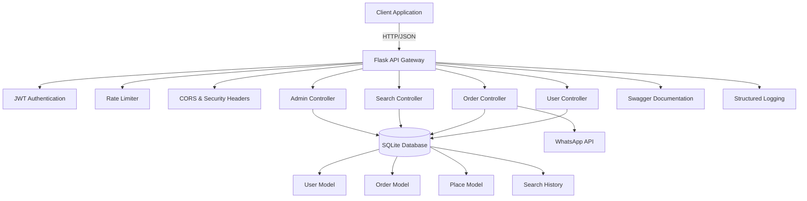

# 🚀 GeoEgy Backend API

> **A comprehensive Flask-based REST API for geolocation business directory and order management system**

[](https://python.org)
[](https://flask.palletsprojects.com/)
[](https://sqlalchemy.org/)
[](https://flask-jwt-extended.readthedocs.io/)
[](LICENSE)

**GeoEgy Backend empowers businesses to connect with customers through location-based services, featuring comprehensive place management, order processing, and integrated WhatsApp notifications.**

[API Documentation](#-api-reference) • [Live Demo](#-quick-start) • [Contributing](#-contributing) • [Deployment](#-deployment)

---

## ⚡ Quick Start

### Prerequisites
- **Python 3.8+** with pip package manager
- **SQLite** (included with Python)
- **Redis** (optional, for rate limiting in production)

### Installation
```bash
# Clone the repository
git clone https://github.com/your-username/geoegy-backend.git
cd geoegy-backend

# Install dependencies
pip install -r requirements.txt

# Set up environment variables (optional)
cp .env.example .env  # Edit with your configuration
```

### Basic Usage
```bash
# Start the development server
python run.py

# Or using WSGI for production
gunicorn --bind 0.0.0.0:5000 wsgi:app
```

**✨ That's it! Your API server is running at http://127.0.0.1:5000**

Access the interactive API documentation at: `http://127.0.0.1:5000/apidocs`

---

## 🌟 Features

### Core Capabilities
- **🔐 JWT Authentication** - Secure user authentication with automatic registration
- **📍 Advanced Place Search** - Intelligent search across business names, categories, and locations  
- **📋 Order Management** - Complete order lifecycle from placement to fulfillment
- **👥 User Profiles** - Comprehensive user management with WhatsApp integration
- **🛡️ Admin Controls** - Administrative features for order oversight and user management
- **⚡ Rate Limiting** - Built-in protection against API abuse
- **📊 Search Analytics** - Track and analyze user search patterns

### What Makes This Special
- **Zero-configuration setup** - SQLite database auto-creates on first run
- **Production-ready security** - JWT tokens, rate limiting, CORS, and Talisman security headers
- **WhatsApp Integration** - Seamless notification system for order updates
- **Comprehensive logging** - Structured logging with Loguru for debugging and monitoring
- **Auto-documentation** - Swagger/OpenAPI docs generated automatically

### Egyptian Market Focus
- **Governorate-based pricing** - Flexible pricing model based on Egyptian administrative divisions
- **Arabic language support** - Full Unicode support for Arabic place names and descriptions
- **Local business optimization** - Designed specifically for Egyptian business directory needs

---

## 📚 API Reference

### Authentication Endpoints

#### `POST /api/user/login`
Authenticate user or auto-register new users
```bash
curl -X POST http://localhost:5000/api/user/login \
  -H "Content-Type: application/json" \
  -d '{"phone_number": "+201234567890"}'
```

**Response:**
```json
{
  "code": 200,
  "message": "Login successful",
  "data": {
    "access_token": "eyJ0eXAiOiJKV1QiLCJhbGciOiJIUzI1NiJ9..."
  }
}
```

#### `GET /api/user/profile`
Get current user profile information
```bash
curl -X GET http://localhost:5000/api/user/profile \
  -H "Authorization: Bearer YOUR_JWT_TOKEN"
```

### Place Search

#### `GET /api/search/places?query=restaurant`
Search for places by name, category, or description
```bash
curl -X GET "http://localhost:5000/api/search/places?query=restaurant" \
  -H "Authorization: Bearer YOUR_JWT_TOKEN"
```

**Response:**
```json
{
  "code": 200,
  "message": "Success",
  "data": [
    {
      "id": 1,
      "name": "Al Tazaj Restaurant",
      "address": {
        "formatted_address": "123 Tahrir Square, Cairo",
        "governorate": "Cairo"
      },
      "coordinates": {
        "latitude": 30.0444,
        "longitude": 31.2357
      },
      "reviews": {
        "average_rating": 4.5,
        "count": 120
      }
    }
  ]
}
```

### Order Management

#### `POST /api/order/place`
Place a new order for business directory services
```bash
curl -X POST http://localhost:5000/api/order/place \
  -H "Content-Type: application/json" \
  -H "Authorization: Bearer YOUR_JWT_TOKEN" \
  -d '{
    "place_name": "Al Tazaj Restaurant",
    "business_details": "Fast food restaurant chain",
    "selected_govs": ["Cairo", "Giza"],
    "whatsapp_number": "+201234567890"
  }'
```

#### `GET /api/order/my_orders`
Retrieve all orders for the authenticated user
```bash
curl -X GET http://localhost:5000/api/order/my_orders \
  -H "Authorization: Bearer YOUR_JWT_TOKEN"
```

### Admin Endpoints

#### `POST /api/admin/orders/<order_id>/accept`
Accept and process a customer order (Admin only)

#### `GET /api/admin/orders`
List all orders in the system (Admin only)

---

## 🏗️ Architecture



### Tech Stack
- **Backend Framework**: Flask 2.x with modular blueprint architecture
- **Database**: SQLite with SQLAlchemy ORM and Alembic migrations
- **Authentication**: JWT-based stateless authentication with Flask-JWT-Extended
- **Security**: Flask-Talisman for security headers, CORS support, rate limiting
- **Documentation**: Swagger/OpenAPI with Flasgger auto-generation
- **Testing**: Pytest with Flask testing utilities
- **External APIs**: WhatsApp Business API integration for notifications

### Performance & Scalability
- **Rate Limiting**: 200 requests/day, 50 requests/hour per IP (configurable)
- **Database**: Optimized queries with SQLAlchemy relationship loading
- **Search**: Efficient ILIKE queries with proper indexing strategies
- **Caching**: Ready for Redis integration for session storage and caching

### Security Features
- **JWT Tokens**: Secure, stateless authentication
- **Input Validation**: Comprehensive data validation and sanitization
- **CORS Configuration**: Proper cross-origin resource sharing setup
- **Security Headers**: HTTPS enforcement, content security policies
- **Rate Limiting**: Protection against API abuse and DoS attacks

---

## 🛠️ Development

### Environment Setup
```bash
# Clone and setup
git clone https://github.com/your-username/geoegy-backend.git
cd geoegy-backend

# Create virtual environment
python -m venv venv
source venv/bin/activate  # On Windows: venv\Scripts\activate

# Install development dependencies
pip install -r requirements.txt

# Set up environment variables
export SECRET_KEY="your-secret-key"
export JWT_SECRET_KEY="your-jwt-secret"
export WHATSAPP_API_URL="https://api.whatsapp.com"
export WHATSAPP_API_KEY="your-whatsapp-api-key"
```

### Project Structure
```
geoegy-backend/
├── app/                          # Main application package
│   ├── __init__.py              # App factory and configuration
│   ├── config.py                # Configuration settings
│   ├── models/                  # SQLAlchemy data models
│   │   ├── user.py             # User authentication model
│   │   ├── order.py            # Order management model
│   │   ├── place.py            # Business place model
│   │   └── governorate.py      # Egyptian governorate pricing
│   ├── controllers/             # API route handlers
│   │   ├── user_controller.py  # Authentication endpoints
│   │   ├── order_controller.py # Order management API
│   │   ├── search_controller.py# Place search functionality
│   │   └── admin_controller.py # Administrative controls
│   ├── utils/                   # Helper utilities
│   │   ├── security.py         # Authentication helpers
│   │   ├── validators.py       # Input validation
│   │   └── whatsapp.py         # WhatsApp integration
│   ├── swagger/                 # API documentation
│   └── static/                  # Static assets
├── migrations/                  # Database migration files
├── tests/                       # Test suite
├── logs/                        # Application logs
├── requirements.txt            # Python dependencies
├── run.py                      # Development server
└── wsgi.py                     # Production WSGI entry point
```

### Development Workflow
1. **Feature Development**: Create feature branches from main
2. **Database Changes**: Use Alembic migrations for schema updates
3. **Testing**: Write tests for new features and endpoints
4. **Code Quality**: Use Black formatter and Flake8 linter
5. **Documentation**: Update Swagger docs for API changes

### Database Management
```bash
# Initialize database (automatic on first run)
python run.py

# Create migration for model changes
alembic revision --autogenerate -m "Add new feature"

# Apply migrations
alembic upgrade head

# Reset database (development only)
rm -f app/data/echo.db && python run.py
```

### Testing
```bash
# Run all tests
pytest

# Run with coverage
pytest --cov=app tests/

# Run specific test file
pytest tests/test_controllers.py -v

# Run tests with output
pytest -s tests/
```

---

## 🚀 Deployment

### Production Setup

#### Environment Variables
Create a `.env` file with production values:
```env
SECRET_KEY=your-super-secret-production-key
JWT_SECRET_KEY=your-jwt-production-secret
WHATSAPP_API_URL=https://graph.facebook.com/v17.0
WHATSAPP_API_KEY=your-production-whatsapp-key
FLASK_ENV=production
```

#### Using Gunicorn (Recommended)
```bash
# Install Gunicorn
pip install gunicorn

# Start production server
gunicorn --bind 0.0.0.0:8000 --workers 4 wsgi:app

# With logging
gunicorn --bind 0.0.0.0:8000 --workers 4 \
  --access-logfile logs/access.log \
  --error-logfile logs/error.log \
  wsgi:app
```

#### Docker Deployment
```dockerfile
FROM python:3.9-slim

WORKDIR /app
COPY requirements.txt .
RUN pip install -r requirements.txt

COPY . .
EXPOSE 5000

CMD ["gunicorn", "--bind", "0.0.0.0:5000", "wsgi:app"]
```

#### Database Configuration
- **Development**: SQLite (included)
- **Production**: PostgreSQL or MySQL recommended
- **Backup Strategy**: Regular database backups with rotation

### Monitoring & Logging
- **Application Logs**: Structured logging with Loguru to `logs/app.log`
- **Access Logs**: HTTP access logging via Gunicorn
- **Health Checks**: Built-in endpoint monitoring
- **Performance Metrics**: Ready for integration with monitoring tools

### Scaling Considerations
- **Load Balancer**: Nginx recommended for multiple instances
- **Database**: Migrate to PostgreSQL for high concurrency
- **Caching**: Redis for session storage and query caching
- **File Storage**: External storage for order attachments

---

## 📊 Project Status

- **Development Status**: Active Development
- **Latest Version**: v1.0.0 (Initial Release)
- **API Stability**: Beta - Breaking changes possible
- **Python Compatibility**: 3.8, 3.9, 3.10, 3.11
- **Database Support**: SQLite (dev), PostgreSQL/MySQL (prod)

### Roadmap
- [ ] Real-time order notifications via WebSocket
- [ ] Advanced search with filters and sorting
- [ ] Mobile app integration APIs
- [ ] Multi-language support (Arabic/English)
- [ ] Payment gateway integration
- [ ] Advanced analytics dashboard

---

## 🤝 Contributing

We welcome contributions! This project follows standard open-source practices.

### Development Process
1. **Fork** the repository on GitHub
2. **Clone** your fork locally
3. **Create** a feature branch (`git checkout -b feature/amazing-feature`)
4. **Make** your changes with comprehensive tests
5. **Commit** with clear, descriptive messages
6. **Push** to your branch and submit a pull request

### Code Style
- **Formatting**: Use Black code formatter (`black .`)
- **Linting**: Follow Flake8 guidelines (`flake8 app/`)
- **Imports**: Sort with isort (`isort app/`)
- **Type Hints**: Encouraged for new code

### Commit Message Convention
```
type(scope): brief description

- feat: new feature
- fix: bug fix
- docs: documentation changes
- style: formatting changes
- refactor: code restructuring
- test: adding tests
- chore: maintenance tasks
```

### Testing Requirements
- All new features must include tests
- Maintain test coverage above 80%
- Include integration tests for API endpoints
- Test both success and error scenarios

---

## 🆘 Support

- 📖 **Documentation**: [API Reference](#-api-reference)
- 🐛 **Bug Reports**: [GitHub Issues](https://github.com/your-username/geoegy-backend/issues)
- 💬 **Discussions**: [GitHub Discussions](https://github.com/your-username/geoegy-backend/discussions)
- 📧 **Contact**: [your-email@example.com](mailto:your-email@example.com)

### Troubleshooting

**Common Issues:**

1. **Database Connection Error**
   ```bash
   # Ensure database directory exists
   mkdir -p app/data
   python run.py
   ```

2. **JWT Token Expired**
   ```bash
   # Re-authenticate to get new token
   curl -X POST http://localhost:5000/api/user/login \
     -H "Content-Type: application/json" \
     -d '{"phone_number": "YOUR_PHONE"}'
   ```

3. **Rate Limit Exceeded**
   ```bash
   # Wait for rate limit reset or configure Redis for production
   # Default: 200/day, 50/hour per IP
   ```

---

## 📄 License

This project is licensed under the **MIT License** - see the [LICENSE](LICENSE) file for details.

### License Summary
- ✅ Commercial use
- ✅ Modification
- ✅ Distribution
- ✅ Private use
- ❌ Liability
- ❌ Warranty

---

## 🙏 Acknowledgments

- **Flask Community** - For the excellent web framework and ecosystem
- **SQLAlchemy Team** - For the powerful ORM and database toolkit
- **JWT Extended** - For secure authentication implementation
- **Egyptian Tech Community** - For inspiration and local market insights
- **Open Source Contributors** - For making this project possible

### Built With
- [Flask](https://flask.palletsprojects.com/) - Web framework
- [SQLAlchemy](https://sqlalchemy.org/) - Database ORM
- [JWT Extended](https://flask-jwt-extended.readthedocs.io/) - Authentication
- [Swagger](https://swagger.io/) - API documentation
- [Loguru](https://loguru.readthedocs.io/) - Structured logging

---

<div align="center">

**⭐ Star this repository if you find it helpful!**

[Report Bug](https://github.com/your-username/geoegy-backend/issues) · [Request Feature](https://github.com/your-username/geoegy-backend/issues) · [Contribute](CONTRIBUTING.md)

</div>
